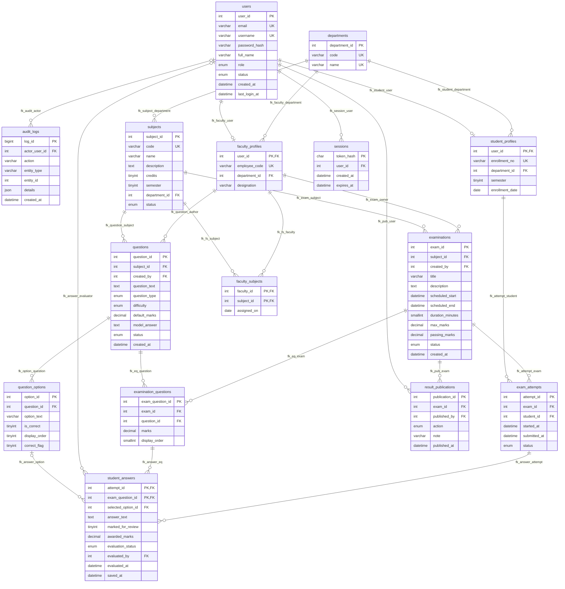

# ER diagram (generated from the implemented schema)

Generated by `docs/tools/gen_er.py` from `information_schema`, so every table, column, key and relationship below exists in `database/01_schema.sql`.
Key: **PK** primary key, **FK** foreign key, **UK** single-column unique. Composite unique constraints (for example `(exam_id, student_id)`) are listed in `database-design.md`.

## Relationships and deletion rules

| Parent (one) | Child | Foreign key column(s) | Cardinality (parent : child) | ON DELETE | Constraint |
|---|---|---|---|---|---|
| `departments` | `faculty_profiles` | `department_id` | 1 : N | RESTRICT | `fk_faculty_department` |
| `departments` | `student_profiles` | `department_id` | 1 : N | RESTRICT | `fk_student_department` |
| `departments` | `subjects` | `department_id` | 1 : N | RESTRICT | `fk_subject_department` |
| `exam_attempts` | `student_answers` | `attempt_id` | 1 : N | CASCADE | `fk_answer_attempt` |
| `examination_questions` | `student_answers` | `exam_question_id` | 1 : N | RESTRICT | `fk_answer_eq` |
| `examinations` | `exam_attempts` | `exam_id` | 1 : N | RESTRICT | `fk_attempt_exam` |
| `examinations` | `examination_questions` | `exam_id` | 1 : N | CASCADE | `fk_eq_exam` |
| `examinations` | `result_publications` | `exam_id` | 1 : N | RESTRICT | `fk_pub_exam` |
| `faculty_profiles` | `examinations` | `created_by` | 1 : N | RESTRICT | `fk_exam_owner` |
| `faculty_profiles` | `faculty_subjects` | `faculty_id` | 1 : N | CASCADE | `fk_fs_faculty` |
| `faculty_profiles` | `questions` | `created_by` | 1 : N | RESTRICT | `fk_question_author` |
| `question_options` | `student_answers` | `selected_option_id` | 0..1 : N | RESTRICT | `fk_answer_option` |
| `questions` | `examination_questions` | `question_id` | 1 : N | RESTRICT | `fk_eq_question` |
| `questions` | `question_options` | `question_id` | 1 : N | CASCADE | `fk_option_question` |
| `student_profiles` | `exam_attempts` | `student_id` | 1 : N | RESTRICT | `fk_attempt_student` |
| `subjects` | `examinations` | `subject_id` | 1 : N | RESTRICT | `fk_exam_subject` |
| `subjects` | `faculty_subjects` | `subject_id` | 1 : N | CASCADE | `fk_fs_subject` |
| `subjects` | `questions` | `subject_id` | 1 : N | RESTRICT | `fk_question_subject` |
| `users` | `audit_logs` | `actor_user_id` | 0..1 : N | SET NULL | `fk_audit_actor` |
| `users` | `faculty_profiles` | `user_id` | 1 : 0..1 | CASCADE | `fk_faculty_user` |
| `users` | `result_publications` | `published_by` | 1 : N | RESTRICT | `fk_pub_user` |
| `users` | `sessions` | `user_id` | 1 : N | CASCADE | `fk_session_user` |
| `users` | `student_answers` | `evaluated_by` | 0..1 : N | RESTRICT | `fk_answer_evaluator` |
| `users` | `student_profiles` | `user_id` | 1 : 0..1 | CASCADE | `fk_student_user` |

`ON DELETE RESTRICT` blocks deleting a parent that still has children (history is preserved); `CASCADE` removes dependent rows that have no meaning alone (for example a user's session or an exam's question assignments); `SET NULL` keeps the log row but forgets the actor.
